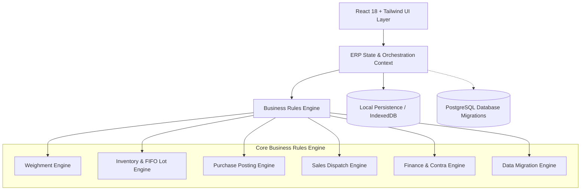

# Yasoth Enterprises Scrap ERP — System Architecture

## 1. Architectural Philosophy

The Yasoth Enterprises Scrap ERP is designed as a **production-oriented, offline-resilient, authoritative business platform**. Rather than treating accounting and stock as editable input fields, all operational balances are derived from immutable, append-only event ledgers.



---

## 2. Layered Structure

```
c:\Users\USER\Downloads\YE\
├── database/
│   ├── migrations/
│   │   ├── 001_initial_schema.sql         # 20 Normalized tables with check constraints & indexes
│   │   └── 002_views_and_functions.sql    # Analytical SQL views for stock, party ledgers & balances
│   └── seed/
│       └── dev_seed.sql                   # Realistic dev fixtures (never used in production)
├── backend/
│   └── business-rules/
│       ├── inventoryEngine.ts             # Non-negative stock guards, FIFO lot allocation & reversals
│       ├── purchaseEngine.ts              # Purchase approval workflow & idempotent lot generation
│       ├── salesEngine.ts                 # Sales dispatch, COGS calculation & immutable invoice creation
│       ├── financeEngine.ts               # Payment vouchers, invoice allocations & contra transfers
│       └── dataMigration.ts               # CSV validation, duplicate detection & dry-run simulations
├── src/
│   ├── app/
│   │   └── router.tsx                     # React Router definition for all 14 modules
│   ├── components/
│   │   ├── common/                        # StatusBadge, StatCard, Modal, DataTable
│   │   ├── layout/                        # AppLayout (collapsible sidebar, role switcher, header)
│   │   └── invoice/                       # InvoiceRenderer (A4 Tax Invoice matching TEJAS layout)
│   ├── context/
│   │   └── ERPContext.tsx                 # Central transactional React Context & local persistence
│   ├── modules/                           # 14 distinct ERP operational modules
│   ├── services/
│   │   └── mockData.ts                    # Verified initial fixtures from company letterhead
│   ├── types/
│   │   └── index.ts                       # Strongly-typed domain models
│   └── utils/
│       └── calculations.ts                # GST breakdowns, Indian numbering words & decimal math
└── tests/                                 # 21 Vitest business-critical automated tests
```

---

## 3. Key Architectural Decisions

### 3.1. Append-Only Stock Ledger
- Transactions never overwrite an editable stock balance column.
- Inward purchases create `PURCHASE_RECEIPT` movements and new `InventoryLot` records.
- Dispatches create `SALES_DISPATCH` negative movements.
- Physical stock audit count differences create approved `STOCK_ADJUSTMENT` or `STOCK_LOSS` movements.
- Net stock at any moment is `SUM(quantity)`.

### 3.2. First-In, First-Out (FIFO) Lot Costing
- Dispatched materials are allocated to the oldest unexhausted inventory lots.
- Cost of Goods Sold (COGS) is computed from the exact lot unit costs consumed.
- Profitability and Gross Margin are calculated as `Net Sales Revenue - COGS`, avoiding the fallacy of subtracting daily purchases from daily sales.

### 3.3. Dual Cash/Bank Contra Transfer Integrity
- Inter-account fund transfers (e.g., cash box to City Union Bank) atomically create a Credit on the source account and a Debit on the destination account.
- Contra transfers strictly bypass revenue and expense recognition.

### 3.4. Immutable Tax Invoice Snapshots
- Issued invoices generate an immutable JSON snapshot embedded directly into the record.
- Future edits to party master or material prices cannot retroactively alter previously issued tax invoices.
