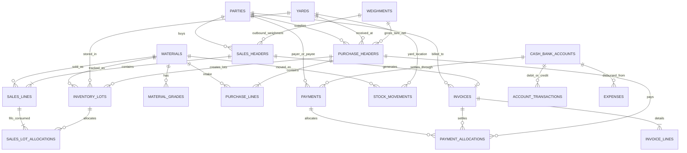

# Yasoth Enterprises Scrap ERP — Database Schema Documentation

## 1. Schema Overview

The database is normalized across 20 primary relational tables and tracked via versioned SQL migrations located in `database/migrations/`:
- `001_initial_schema.sql`: Core tables, primary keys, foreign keys, check constraints, and performance indexes.
- `002_views_and_functions.sql`: Analytical SQL views for stock balances, party ledgers, and reconciled cash/bank balances.

---

## 2. Entity Relational Model

---

## 3. Core Tables Specification

### 3.1. `parties`
Unified master for suppliers, customers, and dual-role commercial partners.
- `id` (UUID, PK)
- `party_code` (VARCHAR(50), UNIQUE)
- `legal_name` (VARCHAR(255), NOT NULL)
- `trade_name` (VARCHAR(255))
- `party_type` (VARCHAR(20), CHECK `IN ('SUPPLIER', 'CUSTOMER', 'BOTH')`)
- `contact_person` (VARCHAR(255))
- `phone` (VARCHAR(50), NOT NULL)
- `gstin` (VARCHAR(20))
- `credit_limit` (DECIMAL(14, 2))
- `opening_balance` (DECIMAL(14, 2), Positive = Receivable, Negative = Payable)
- `opening_balance_date` (DATE)

### 3.2. `materials` & `material_grades`
Configurable scrap master classifications.
- `id` (UUID, PK)
- `code` (VARCHAR(50), UNIQUE)
- `name` (VARCHAR(255), NOT NULL)
- `category` (VARCHAR(100), Steel, Iron, Aluminium, Copper, Brass, Plastic)
- `base_unit` (VARCHAR(20), DEFAULT 'KG')
- `hsn_code` (VARCHAR(20), DEFAULT '7204')
- `default_purchase_rate` (DECIMAL(12, 2))
- `default_sales_rate` (DECIMAL(12, 2))
- `default_gst_rate` (DECIMAL(5, 2), DEFAULT 18.00)
- `min_stock_alert` (DECIMAL(12, 3))

### 3.3. `weighments`
Authoritative weight slip register.
- `id` (UUID, PK)
- `weighment_no` (VARCHAR(50), UNIQUE)
- `weighing_method` (VARCHAR(20), CHECK `IN ('MANUAL_SCALE', 'WEIGHBRIDGE_SLIP', 'HARDWARE_LINK')`)
- `slip_reference` (VARCHAR(100))
- `vehicle_registration` (VARCHAR(50))
- `gross_weight` (DECIMAL(12, 3), CHECK `>= 0`)
- `tare_weight` (DECIMAL(12, 3), CHECK `>= 0`)
- `net_weight` (DECIMAL(12, 3), STORED `(gross_weight - tare_weight)`)
- `approved_deductions` (DECIMAL(12, 3), CHECK `>= 0`)
- `payable_weight` (DECIMAL(12, 3), STORED `(gross_weight - tare_weight - approved_deductions)`)
- Constraints: `CHECK (gross_weight >= tare_weight)`, `CHECK (approved_deductions <= (gross_weight - tare_weight))`

### 3.4. `inventory_lots` & `stock_movements`
Immutable append-only ledger and FIFO lot costing.
- `inventory_lots`:
  - `id` (UUID, PK)
  - `lot_number` (VARCHAR(50), UNIQUE)
  - `material_id` (UUID, FK `materials`)
  - `yard_id` (UUID, FK `yards`)
  - `initial_quantity` (DECIMAL(12, 3), CHECK `> 0`)
  - `remaining_quantity` (DECIMAL(12, 3), CHECK `>= 0`)
  - `unit_cost` (DECIMAL(12, 2), CHECK `>= 0`)
  - `received_at` (TIMESTAMPTZ)
  - `is_exhausted` (BOOLEAN)
- `stock_movements`:
  - `id` (UUID, PK)
  - `movement_type` (VARCHAR(30), CHECK in `PURCHASE_RECEIPT`, `COLLECTION_RECEIPT`, `SALES_DISPATCH`, `YARD_TRANSFER_IN`, `YARD_TRANSFER_OUT`, `STOCK_ADJUSTMENT`, `STOCK_LOSS`, `REVERSAL`, `OPENING_STOCK`)
  - `quantity` (DECIMAL(12, 3), Positive = Inward, Negative = Outward)
  - `unit_cost` (DECIMAL(12, 2))
  - `total_cost` (DECIMAL(14, 2))
  - `reversal_movement_id` (UUID, FK self-referential)

### 3.5. `invoices` & `invoice_lines`
Official GST Tax Invoice records.
- `id` (UUID, PK)
- `invoice_no` (VARCHAR(50), UNIQUE)
- `customer_party_id` (UUID, FK `parties`)
- `subtotal_taxable` (DECIMAL(14, 2))
- `cgst_rate` (DECIMAL(5, 2), DEFAULT 9.00)
- `cgst_amount` (DECIMAL(14, 2))
- `sgst_rate` (DECIMAL(5, 2), DEFAULT 9.00)
- `sgst_amount` (DECIMAL(14, 2))
- `round_off` (DECIMAL(6, 2))
- `grand_total` (DECIMAL(14, 2))
- `amount_in_words` (TEXT)
- `immutable_snapshot_json` (JSONB, Permanent snapshot of issued invoice)

---

## 4. Analytical Views

1. **`v_material_stock_summary`**: Computes `total_inward_kg`, `total_outward_kg`, `current_stock_kg`, `weighted_avg_cost`, and `stock_valuation_amount` for each material and yard.
2. **`v_party_balances`**: Reconciles each supplier/customer's opening balance, total invoiced sales, total collections, total purchases, and total supplier payments into `current_net_balance`.
3. **`v_account_balances`**: Reconciles each cash box and bank account's opening balance, total debits, and total credits into `current_reconciled_balance`.
