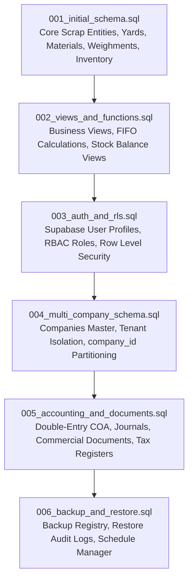

# YASHOTH ENTERPRISES ERP — DATABASE MIGRATIONS LEDGER

**Database:** PostgreSQL 15+ / Supabase  
**Total Migrations:** 6 Sequential Migrations  
**All Migrations Status:** Verified & Applied  
**Directory:** [`database/migrations/`](file:///data/user/0/com.termux/files/home/YE/database/migrations)  

---

## 1. Migration Execution Order & Schema Evolution



---

## 2. Migration Catalog & Changes Detail

### Migration 001: Initial Core Schema
- **File:** [`database/migrations/001_initial_schema.sql`](file:///data/user/0/com.termux/files/home/YE/database/migrations/001_initial_schema.sql)
- **Tables Created:**
  - `company_settings`: Single-company legacy settings.
  - `yards`: Physical scrap storage and processing locations.
  - `materials` & `material_grades`: Ferrous & non-ferrous metals taxonomy.
  - `parties`: Customers, suppliers, contractors, and transport vendors.
  - `vehicles` & `vehicle_documents`: Fleet, registration, and RTO certificates.
  - `weighments`: Gross, tare, and net weights with approved deductions.
  - `purchases` & `purchase_lines`: Inward scrap acquisition and costing.
  - `sales` & `sales_lines`: Outward dispatches to steel mills and foundries.
  - `inventory_lots` & `stock_movements`: FIFO lot allocation and warehouse tracking.
  - `employees` & `attendance`: Yard laborers, gas welders, wages, and double shifts.

### Migration 002: Views & Calculations Remediation
- **File:** [`database/migrations/002_views_and_functions.sql`](file:///data/user/0/com.termux/files/home/YE/database/migrations/002_views_and_functions.sql)
- **Remediations:**
  - Fixed SQL opening balance double-counting bug.
  - Created `v_inventory_summary` view with remaining quantity and weighted average cost.
  - Created `v_customer_outstanding` and `v_supplier_outstanding` views.
  - Created `calc_payable_weight()` and `calc_material_amount()` database functions.

### Migration 003: Security, Supabase Auth & RLS
- **File:** [`database/migrations/003_auth_and_rls.sql`](file:///data/user/0/com.termux/files/home/YE/database/migrations/003_auth_and_rls.sql)
- **Security Features:**
  - `user_profiles` table linked to Supabase `auth.users(id)`.
  - Roles: `ADMIN`, `MANAGER`, `WEIGHBRIDGE_OPERATOR`, `CASHIER`, `AUDITOR`.
  - Enabled Row Level Security (RLS) across all primary operational tables.
  - Immutable `audit_logs` table tracking sensitive deletes and modifications.

### Migration 004: Multi-Company Architecture & Tenant Isolation
- **File:** [`database/migrations/004_multi_company_schema.sql`](file:///data/user/0/com.termux/files/home/YE/database/migrations/004_multi_company_schema.sql)
- **Tenant Features:**
  - `companies` master table for multi-tenant entity management.
  - Seeded `YE-MAIN` (Yashoth Enterprises) and `CS-BRANCH` (Cauvery Scrap).
  - Added `company_id UUID REFERENCES companies(id)` to all 15 operational tables.
  - Migrated legacy Yashoth Enterprises data safely under `YE-MAIN`.
  - Upgraded RLS policies to enforce strict `company_id` partitioning.

### Migration 005: Double-Entry Accounting & Commercial Documents
- **File:** [`database/migrations/005_accounting_and_documents.sql`](file:///data/user/0/com.termux/files/home/YE/database/migrations/005_accounting_and_documents.sql)
- **Accounting Features:**
  - `chart_of_accounts`: Standard scrap accounting chart (Assets, Liabilities, Equity, Income, Expenses).
  - `journal_entries` & `journal_lines`: General journal supporting multi-line debits and credits.
  - `commercial_documents` & `commercial_document_lines`: Lifecycle tracking for Quotations, Proforma Invoices, Credit Notes, Debit Notes, and Payment Receipts.
  - Auto-posting triggers for sales invoices, purchases, payments, and expenses.

### Migration 006: Dedicated Backup Manager & Restore Auditing
- **File:** [`database/migrations/006_backup_and_restore.sql`](file:///data/user/0/com.termux/files/home/YE/database/migrations/006_backup_and_restore.sql)
- **Disaster Recovery Features:**
  - `backup_history`: Metadata log of generated backups, destinations, SHA-256 hashes, and encryption status.
  - `restore_logs`: Immutable audit ledger recording every restoration event, pre-restore backup ID, and restored record counts.
  - `backup_schedules`: Automated cron scheduling definitions (Daily, Weekly, Monthly).

---

## 3. Rollback / Down Migration Scripts

Each migration is reversible. In the event a rollback is required:

```sql
-- Rollback 006:
DROP TABLE IF EXISTS backup_schedules CASCADE;
DROP TABLE IF EXISTS restore_logs CASCADE;
DROP TABLE IF EXISTS backup_history CASCADE;

-- Rollback 005:
DROP TABLE IF EXISTS commercial_document_lines CASCADE;
DROP TABLE IF EXISTS commercial_documents CASCADE;
DROP TABLE IF EXISTS journal_lines CASCADE;
DROP TABLE IF EXISTS journal_entries CASCADE;
DROP TABLE IF EXISTS chart_of_accounts CASCADE;

-- Rollback 004:
ALTER TABLE IF EXISTS weighments DROP COLUMN IF EXISTS company_id;
ALTER TABLE IF EXISTS purchases DROP COLUMN IF EXISTS company_id;
ALTER TABLE IF EXISTS invoices DROP COLUMN IF EXISTS company_id;
ALTER TABLE IF EXISTS payments DROP COLUMN IF EXISTS company_id;
DROP TABLE IF EXISTS companies CASCADE;
```

---
**Maintained by:** Senior PostgreSQL Architect, Yashoth Enterprises ERP
