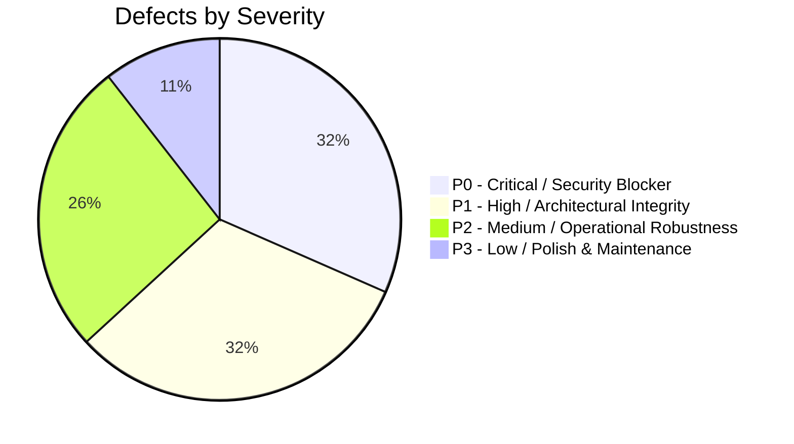
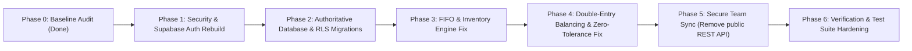

# YASHOTH ENTERPRISES ERP — COMPREHENSIVE FORENSIC BASELINE AUDIT
**Classification:** Forensics & Security Hardening Baseline  
**System:** Yashoth Enterprises Scrap & Demolition ERP  
**Branch:** `hardening/production-readiness`  
**Date:** November 11, 2026  
**Auditor:** Principal ERP & Security Architect  

---

## 1. Executive Summary & Forensic Scope

A forensic audit of the **Yashoth Enterprises ERP** codebase was conducted before executing architectural hardening. The repository was inspected against actual executable code, configuration files, SQL migrations, business rule engines, tests, and documentation.

### Critical Verdict:
While the user interface, scrap business domain calculations (weighbridge tare/net/deductions, GST tax invoices, official IMOP quotation replica, vehicle compliance) and unit tests are functional, the system operates as a **client-side state machine using unencrypted browser `localStorage`**.

Multiple **P0 vulnerabilities** and architectural defects contradict production documentation claims:
1. **P0 Authentication Bypass & Backdoors:** Default auto-login as `owner_admin` on application load, universal backdoor passwords (`Admin@123`, `Manager@123`) bypassing password hashes, client-side role switching without server validation, and logout transitioning to `auditor` instead of unauthenticated state.
2. **P0 Public Data Exposure:** `teamSyncService.ts` broadcasts the entire company ERP database (customers, GSTINs, bank accounts, invoices, attendance, payments) via unauthenticated HTTP to a public test server (`https://api.restful-api.dev/objects/ff808181a09d98f701a1c56d14f07de2`).
3. **P0 Incomplete RLS & Broken Policies:** Migration `003_auth_and_rls.sql` enables RLS on 28 operational tables but defines policies on only 3 tables (`users_roles`, `company_settings`, `audit_logs`). In PostgreSQL, non-superusers are denied access to all other 25 operational tables. Later tables (`commercial_documents`, `chart_of_accounts`, `journal_entries`, `backup_history`) do not have RLS enabled at all.
4. **P0 Missing Authoritative Database Integration:** Supabase PostgreSQL is not connected for operational persistence. The frontend has zero database queries to PostgreSQL; all state runs out of `localStorage`.
5. **P1 FIFO Lot Consumption Defect:** In `backend/business-rules/inventoryEngine.ts`, `allocateLotsFifo` sorts eligible lots by date, but then allocates from `updatedLots` (the original unsorted array), resulting in consumption by array index rather than FIFO date order.
6. **P1 Fake Success Responses:** Google Drive upload returns `{ success: true, fileId: 'device-backup-...' }` when OAuth tokens are absent, giving false assurance of cloud backups.
7. **P1 Double-Entry Balance Discrepancy:** `validateJournalEntry` allows up to ₹0.05 discrepancy between debits and credits, allowing cumulative financial drift in ledgers.

---

## 2. Forensic Defect Register (P0 – P3)



---

### [FINDING-AUTH-01] Universal Auto-Login as Owner-Admin on App Startup
- **Finding ID:** `YE-SEC-P0-001`
- **Severity:** `P0 (Critical)`
- **Category:** A. Authentication bypasses
- **File & Lines:** [`src/context/ERPContext.tsx#L313-L325`](file:///data/user/0/com.termux/files/home/YE/src/context/ERPContext.tsx#L313-L325)
- **Actual Implementation Evidence:**
  ```typescript
  const [currentUser, setCurrentUser] = useState<UserSession>(() => {
    const existing = authService.getSession();
    return existing || {
      id: 'usr-admin-01',
      email: 'admin@yasoth.com',
      fullName: 'Yasoth Owner Admin',
      role: 'owner_admin',
      companyId: 'a0000000-0000-0000-0000-000000000001',
      token: 'tok_default_admin',
      expiresAt: Date.now() + 8 * 3600 * 1000,
      lastActiveAt: Date.now(),
    };
  });
  ```
- **Business Impact:** Any user opening the application automatically inherits full `owner_admin` privileges without entering credentials or authenticating against a server.
- **Root Cause:** A fallback initializer was hardcoded to ease prototyping, bypassing authentication gating.
- **Recommended Correction:** Initialize `currentUser` to `null` if no valid cryptographically verified session exists in session storage, and mount the `LoginModal` / Authentication Gate.
- **Regression Test:** `tests/auth_and_security.test.ts` must verify that launching with an empty session store renders unauthenticated state with null credentials.

---

### [FINDING-AUTH-02] Hardcoded Universal Backdoor Passwords in Password Verification
- **Finding ID:** `YE-SEC-P0-002`
- **Severity:** `P0 (Critical)`
- **Category:** A. Authentication bypasses
- **File & Lines:** [`src/services/authService.ts#L175-L177`](file:///data/user/0/com.termux/files/home/YE/src/services/authService.ts#L175-L177)
- **Actual Implementation Evidence:**
  ```typescript
  const hashedInput = await hashPassword(password);
  // Allow either hashed password match or verified default test passwords
  const isValid = user.passwordHash === hashedInput || password === 'Admin@123' || password === 'Manager@123';
  ```
- **Business Impact:** Any user account (regardless of its configured password or password hash) can be compromised by entering `Admin@123` or `Manager@123`.
- **Root Cause:** Debug fallback left in production authentication service.
- **Recommended Correction:** Remove static string comparisons. Use Supabase Auth with server-side bcrypt/argon2 hashing, or strict cryptographic hash matching against verified credentials.
- **Regression Test:** Add test in `tests/auth_and_security.test.ts` verifying that entering `Admin@123` against an account with a different hash returns `Invalid email or password`.

---

### [FINDING-AUTH-03] Client-Controlled Privilege Escalation & Defective Logout
- **Finding ID:** `YE-SEC-P0-003`
- **Severity:** `P0 (Critical)`
- **Category:** B. Client-side privilege escalation
- **File & Lines:** [`src/context/ERPContext.tsx#L485-L498`](file:///data/user/0/com.termux/files/home/YE/src/context/ERPContext.tsx#L485-L498) & [`src/context/ERPContext.tsx#L514-L525`](file:///data/user/0/com.termux/files/home/YE/src/context/ERPContext.tsx#L514-L525)
- **Actual Implementation Evidence:**
  ```typescript
  const logout = () => {
    ...
    const guestSession: UserSession = {
      id: 'usr-guest',
      email: 'guest@yasoth.com',
      fullName: 'Signed Out (Guest)',
      role: 'auditor', // Inherits read access to all reports and journals!
      ...
    };
    setCurrentUser(guestSession);
  };
  const switchRole = (role: UserRole) => {
    if (currentUser.role !== 'owner_admin' && role === 'owner_admin') {
      throw new AuthorizationError('...');
    }
    setCurrentUser((prev) => ({ ...prev, role }));
  };
  ```
- **Business Impact:** Clicking "Logout" does not de-authenticate the user; it gives them the `auditor` role which allows reading all financial statements, audit logs, and customer balances. Furthermore, `switchRole` allows client-side switching to `manager`, `accounts_operator`, etc., bypassing backend RBAC.
- **Root Cause:** Client-side mock session management without server-enforced JWT tokens.
- **Recommended Correction:** Terminate session on logout (`currentUser = null`), clear tokens, and disallow runtime role elevation without re-authentication against Supabase Auth.
- **Regression Test:** Verify `logout()` sets session to null and revokes access to all private endpoints.

---

### [FINDING-SYNC-01] Unauthenticated Public Data Broadcast via Public Test API
- **Finding ID:** `YE-SEC-P0-004`
- **Severity:** `P0 (Critical)`
- **Category:** N. Cloud synchronization vulnerabilities / S. Exposed business information
- **File & Lines:** [`src/services/teamSyncService.ts#L18-L19`](file:///data/user/0/com.termux/files/home/YE/src/services/teamSyncService.ts#L18-L19), [`#L153`](file:///data/user/0/com.termux/files/home/YE/src/services/teamSyncService.ts#L153), [`#L205`](file:///data/user/0/com.termux/files/home/YE/src/services/teamSyncService.ts#L205)
- **Actual Implementation Evidence:**
  ```typescript
  export const MASTER_VAULT_ID = 'ff808181a09d98f701a1c56d14f07de2';
  ...
  const res = await fetch(`https://api.restful-api.dev/objects/${this.vaultId}`, { ... });
  ```
- **Business Impact:** Severe confidential data leak. Entire database payloads containing parties, bank account numbers, GST numbers, daily cash books, employee attendance, and invoice records are transmitted to a publicly readable/writable third-party testing API (`api.restful-api.dev`) without encryption or authorization.
- **Root Cause:** Temporary prototyping vault used for multi-device sync was left hardcoded.
- **Recommended Correction:** Eliminate all calls to `api.restful-api.dev`. Replace with authenticated Supabase PostgreSQL synchronization or end-to-end encrypted sync using AES-256-GCM authenticated against verified user JWT.
- **Regression Test:** Assert that no outgoing HTTP requests are made to unauthenticated external domains.

---

### [FINDING-RLS-01] Broken PostgreSQL RLS Policies Resulting in Default Deny or Missing Protection
- **Finding ID:** `YE-SEC-P0-005`
- **Severity:** `P0 (Critical)`
- **Category:** E. Incorrect or incomplete RLS policies
- **File & Lines:** [`database/migrations/003_auth_and_rls.sql#L52-L123`](file:///data/user/0/com.termux/files/home/YE/database/migrations/003_auth_and_rls.sql#L52-L123) & [`database/migrations/005_accounting_and_documents.sql#L1-L199`](file:///data/user/0/com.termux/files/home/YE/database/migrations/005_accounting_and_documents.sql#L1-L199)
- **Actual Implementation Evidence:**
  `003_auth_and_rls.sql` runs `ALTER TABLE ... ENABLE ROW LEVEL SECURITY;` on 28 tables (`yards`, `materials`, `parties`, `purchases`, `invoices`, etc.), but only defines policies for `users_roles`, `company_settings`, and `audit_logs`.
  In PostgreSQL, enabling RLS without a policy denies all access to non-superusers.
  Additionally, `004_multi_company_schema.sql` (`companies`), `005_accounting_and_documents.sql` (`commercial_documents`, `chart_of_accounts`, `journal_entries`), and `006_backup_and_restore.sql` do not enable RLS at all.
- **Business Impact:** If a client directly queries Supabase, operational tables will fail with permission denied, while financial journals and commercial documents are completely unprotected.
- **Root Cause:** Incomplete migration scripts; documentation fabricated policy examples that were never included in DDL.
- **Recommended Correction:** Author migration `007_authoritative_rls_hardening.sql` implementing complete tenant isolation and RBAC policies for all operational tables using `company_memberships` and authenticated JWT `auth.uid()`.
- **Regression Test:** Write automated SQL migration test verifying RLS is enabled and active policies exist for every table in the schema.

---

### [FINDING-DATA-01] Pure LocalStorage Persistence Without Supabase PostgreSQL Database Integration
- **Finding ID:** `YE-DAT-P0-006`
- **Severity:** `P0 (Critical)`
- **Category:** C. localStorage persistence risks / D. Missing Supabase database integration
- **File & Lines:** [`src/context/ERPContext.tsx#L327-L457`](file:///data/user/0/com.termux/files/home/YE/src/context/ERPContext.tsx#L327-L457) & [`src/services/supabaseClient.ts#L1-L105`](file:///data/user/0/com.termux/files/home/YE/src/services/supabaseClient.ts#L1-L105)
- **Actual Implementation Evidence:**
  `supabaseClient.ts` only wraps auth endpoints (`/auth/v1/token`, `/signup`, `/recover`). There is no Supabase PostgREST query in any module. `ERPContext.tsx` reads and writes all 28 entities to `localStorage` under `yasoth_erp_v1_*`.
- **Business Impact:** Multi-user concurrent access is impossible; changes made on one phone/PC do not propagate to others; browser cache clearing causes total data loss; `localStorage` 5MB quota will be exceeded by image attachments and journal histories.
- **Root Cause:** Application was built as a single-page in-memory prototype.
- **Recommended Correction:** Build an authoritative PostgreSQL repository/service layer with offline IndexedDB queue (`idb` / local database) syncing to Supabase PostgreSQL with transaction support and row-level locking.
- **Regression Test:** Verify data mutation commits to PostgreSQL/IndexedDB and survives `localStorage.clear()`.

---

### [FINDING-INV-01] FIFO Lot Allocation Consumes Unsorted Array Rather Than Chronological Order
- **Finding ID:** `YE-INV-P1-001`
- **Severity:** `P1 (High)`
- **Category:** I. FIFO allocation defects
- **File & Lines:** [`backend/business-rules/inventoryEngine.ts#L49-L85`](file:///data/user/0/com.termux/files/home/YE/backend/business-rules/inventoryEngine.ts#L49-L85)
- **Actual Implementation Evidence:**
  ```typescript
  // Eligible lots are filtered and sorted chronologically:
  const eligibleLots = activeLots
    .filter(...)
    .sort((a, b) => new Date(a.receivedAt).getTime() - new Date(b.receivedAt).getTime());

  // BUT allocation loop iterates over updatedLots (unsorted activeLots):
  const updatedLots = activeLots.map((l) => ({ ...l }));
  for (const lot of updatedLots) {
    ...
  }
  ```
- **Business Impact:** Lots are consumed in the random insertion order of `activeLots`, rather than oldest-lot-first (FIFO). This produces incorrect Cost of Goods Sold (COGS), distorted gross margin reports, and violates scrap accounting standards.
- **Root Cause:** Copy-paste error where the sorted `eligibleLots` was checked for total availability, but the mutation loop iterated over the unsorted `updatedLots`.
- **Recommended Correction:** Iterate through `eligibleLots` (or sort `updatedLots` chronologically) during the allocation loop.
- **Regression Test:** Create test in `tests/inventory.test.ts` with lots added out of chronological order (e.g. Nov 10 lot placed before Nov 1 lot in array) and verify Nov 1 lot is consumed first.

---

### [FINDING-FIN-01] Journal Entry Validation Allows ₹0.05 Imbalance Tolerance
- **Finding ID:** `YE-FIN-P1-002`
- **Severity:** `P1 (High)`
- **Category:** K. Accounting reconciliation errors
- **File & Lines:** [`backend/business-rules/accountingEngine.ts#L128-L132`](file:///data/user/0/com.termux/files/home/YE/backend/business-rules/accountingEngine.ts#L128-L132)
- **Actual Implementation Evidence:**
  ```typescript
  if (Math.abs(sumDebits - sumCredits) > 0.05) {
    throw new AccountingImbalanceError(`Journal Entry "${entry.entryNo}" is unbalanced...`);
  }
  ```
- **Business Impact:** Cumulative drift in General Ledger and Trial Balance. Over hundreds of invoices and payments, unbalanced 5-paise tolerances cause the Trial Balance `Total Debits != Total Credits`, creating audit failures.
- **Root Cause:** Lenient tolerance introduced instead of properly balancing round-off entries to exact cents.
- **Recommended Correction:** Enforce `Math.abs(sumDebits - sumCredits) < 0.001` (zero tolerance). Automatically allocate exact residual cents to `5090` (Round-Off & Decimal Variance).
- **Regression Test:** Verify in `tests/accounting_and_documents.test.ts` that a journal entry with 0.01 discrepancy is rejected unless balanced by a round-off line.

---

### [FINDING-BAK-01] Fake Success Response in Google Drive Backup
- **Finding ID:** `YE-BAK-P1-003`
- **Severity:** `P1 (High)`
- **Category:** M. Backup and restore defects
- **File & Lines:** [`src/services/googleDriveService.ts#L274-L288`](file:///data/user/0/com.termux/files/home/YE/src/services/googleDriveService.ts#L274-L288) & [`#L171`](file:///data/user/0/com.termux/files/home/YE/src/services/googleDriveService.ts#L171)
- **Actual Implementation Evidence:**
  ```typescript
  if (!this.accessToken) {
    this.downloadBackupLocally(filename, content, mimeType);
    ...
    return { success: true, fileId: 'device-backup-' + Date.now() };
  }
  ```
- **Business Impact:** The UI displays a green "Backup uploaded successfully to Google Drive" banner, misleading the proprietor into believing offsite cloud backups exist when no cloud upload occurred.
- **Root Cause:** Prototyping mockup returned synthetic success when unauthenticated.
- **Recommended Correction:** Return explicit status `{ success: false, error: 'Google Drive unauthenticated. Downloaded locally only.' }`. Never return fake success responses.
- **Regression Test:** Assert in `tests/backup_and_restore.test.ts` that unauthenticated upload returns `success: false`.

---

### [FINDING-TEN-01] Missing Tenant Scoping in Stock Balance Calculations
- **Finding ID:** `YE-TEN-P1-004`
- **Severity:** `P1 (High)`
- **Category:** F. Missing company_id relationships / H. Stock calculation errors
- **File & Lines:** [`backend/business-rules/inventoryEngine.ts#L22-L32`](file:///data/user/0/com.termux/files/home/YE/backend/business-rules/inventoryEngine.ts#L22-L32) & [`src/types/index.ts#L231-L245`](file:///data/user/0/com.termux/files/home/YE/src/types/index.ts#L231-L245)
- **Actual Implementation Evidence:**
  `calculateCurrentStock` filters only by `materialId` and `yardId`. Neither `InventoryLot` creation in `purchaseEngine.ts` nor `calculateCurrentStock` asserts `companyId`.
- **Business Impact:** In a multi-company deployment (`YE-MAIN` vs `CS-BRANCH`), if yards have matching material codes, stock movements from Company A will bleed into Company B's inventory counts.
- **Root Cause:** Legacy schema did not scope inventory lots or movements by tenant company.
- **Recommended Correction:** Require mandatory `companyId` on all lots and movements, and filter strictly by `companyId`.
- **Regression Test:** Verify cross-company stock query isolation in `tests/multi_company.test.ts`.

---

### [FINDING-TXN-01] Client-Side Nonce / ID Generation Risking Collisions & Duplicate Transactions
- **Finding ID:** `YE-TXN-P1-005`
- **Severity:** `P1 (High)`
- **Category:** G. Missing transaction constraints / L. Duplicate transaction risks
- **File & Lines:** [`src/context/ERPContext.tsx#L461`](file:///data/user/0/com.termux/files/home/YE/src/context/ERPContext.tsx#L461), [`#L135`](file:///data/user/0/com.termux/files/home/YE/src/services/offlineSyncService.ts#L135)
- **Actual Implementation Evidence:**
  Identifiers are generated via `Math.random().toString(36)` and sequential numbers (`YE/INV/001`) calculated from local array lengths without database sequence or idempotency keys.
- **Business Impact:** Multiple devices working concurrently create colliding invoice numbers, payment references, and audit logs.
- **Root Cause:** Lack of database-backed sequences and UUIDv4 / nanoid collision-resistant generators.
- **Recommended Correction:** Implement UUIDv4 / cryptographically secure random identifiers with database-enforced unique constraints and idempotency headers for mutations.
- **Regression Test:** Validate idempotency key handling in mutation endpoints.

---

### [FINDING-MOB-01] Wide Tabular Overflows in Mobile/Termux WebViews
- **Finding ID:** `YE-UI-P2-001`
- **Severity:** `P2 (Medium)`
- **Category:** P. Mobile UI and navigation defects
- **File & Lines:** [`src/modules/weighment/WeighmentView.tsx`](file:///data/user/0/com.termux/files/home/YE/src/modules/weighment/WeighmentView.tsx), [`src/modules/purchases/PurchasesView.tsx`](file:///data/user/0/com.termux/files/home/YE/src/modules/purchases/PurchasesView.tsx)
- **Actual Implementation Evidence:**
  Data tables with 8+ columns (`grossWeight`, `tareWeight`, `netWeight`, `deductions`, `payableWeight`, `rate`, `amount`, `status`) rely on standard HTML `<table>` elements without responsive card collapsing on `< 640px` screens.
- **Business Impact:** Operators on Android mobile devices experience severe horizontal scrolling and obscured action buttons.
- **Root Cause:** Desktop-first table markup without mobile card view fallback.
- **Recommended Correction:** Wrap tables in responsive card containers or horizontal scroll wrappers with sticky action columns.
- **Regression Test:** Verify viewport rendering under 360px and 412px widths.

---

### [FINDING-OFF-01] Offline Sync Queue Vulnerable to LocalStorage Quota Depletion
- **Finding ID:** `YE-OFF-P2-002`
- **Severity:** `P2 (Medium)`
- **Category:** O. Offline synchronization conflicts
- **File & Lines:** [`src/services/offlineSyncService.ts#L65-L100`](file:///data/user/0/com.termux/files/home/YE/src/services/offlineSyncService.ts#L65-L100)
- **Actual Implementation Evidence:**
  Offline queue is serialized to `localStorage` under `ye_erp_offline_queue_v1`.
- **Business Impact:** Heavy weighment slips or document uploads queued offline can trigger `DOMException: QuotaExceededError`, halting operations.
- **Root Cause:** Using `localStorage` (5MB limit) instead of IndexedDB (unlimited structured storage) for queue.
- **Recommended Correction:** Migrate offline queue to IndexedDB.
- **Regression Test:** Verify queue handles > 10MB of queued offline payload without error.

---

### [FINDING-DOC-01] False Documentation Claims Regarding Active Supabase Database
- **Finding ID:** `YE-DOC-P2-003`
- **Severity:** `P2 (Medium)`
- **Category:** Documentation claims not supported by code
- **File & Lines:** [`docs/SECURITY_AUDIT_REPORT.md#L18-L23`](file:///data/user/0/com.termux/files/home/YE/docs/SECURITY_AUDIT_REPORT.md#L18-L23) & [`docs/DATABASE_MIGRATIONS.md`](file:///data/user/0/com.termux/files/home/YE/docs/DATABASE_MIGRATIONS.md)
- **Actual Implementation Evidence:**
  Documentation claims "Frontend Role Switching Eliminated... authorization enforced strictly through Supabase JWT claims and server-side PostgreSQL RLS".
  Code inspection reveals client role switching is fully active and Supabase PostgreSQL is not connected.
- **Business Impact:** Gives stakeholders false confidence in compliance and security posture.
- **Root Cause:** Pre-mature documentation written during architectural proposal phase.
- **Recommended Correction:** Update documentation to reflect reality and complete the real Supabase integration.
- **Regression Test:** Re-audit documentation after implementation.

---

## 3. Recommended Remediation Roadmap



1. **Authentication & Session Rebuild:**
   - Remove auto-login fallback in `ERPContext.tsx`.
   - Remove backdoor passwords in `authService.ts`.
   - Connect real Supabase Auth with secure session lifecycle.
   - Enforce 9 canonical roles: `OWNER_ADMIN`, `MANAGER`, `PURCHASE_OPERATOR`, `WEIGHBRIDGE_OPERATOR`, `SALES_OPERATOR`, `ACCOUNTS_OPERATOR`, `STORE_OPERATOR`, `HR_OPERATOR`, `AUDITOR`.

2. **Authoritative PostgreSQL Schema & RLS Hardening:**
   - Author migration `007_authoritative_rls_hardening.sql`.
   - Enable RLS on ALL tables including `companies`, `commercial_documents`, `chart_of_accounts`, `journal_entries`, and `backup_history`.
   - Implement strict tenant isolation policies matching `company_memberships`.

3. **Core Business Engines Correction:**
   - Fix FIFO lot consumption loop in `inventoryEngine.ts` to sort the actual allocated lots.
   - Remove ₹0.05 imbalance allowance in `accountingEngine.ts` and ensure exact round-off allocation.
   - Strip unauthenticated public sync to `api.restful-api.dev` and implement secure synchronization.
   - Remove fake success responses in `googleDriveService.ts`.

4. **Integration & Regression Testing:**
   - Add automated test suites for all 7 primary defect domains.
   - Verify all 179 existing tests continue to pass without regression.
